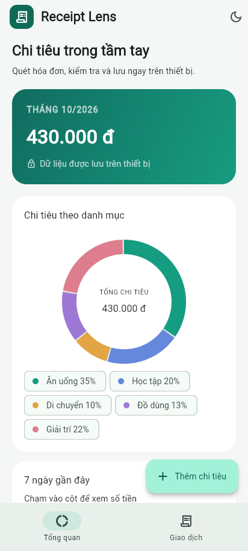
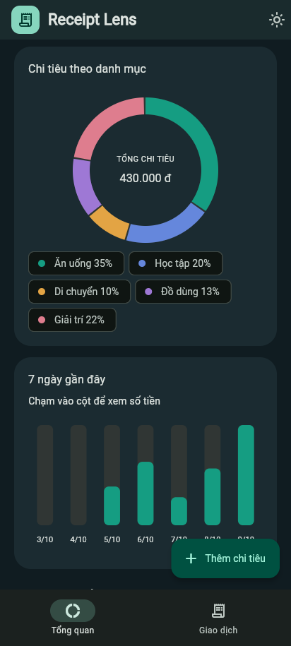
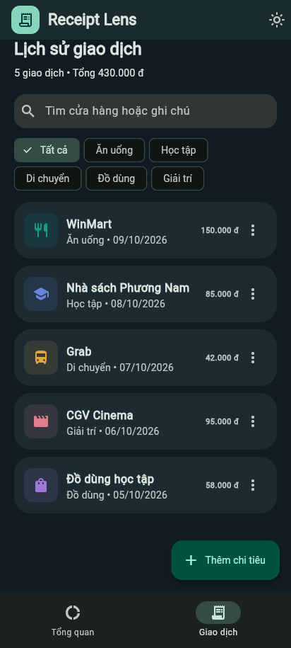
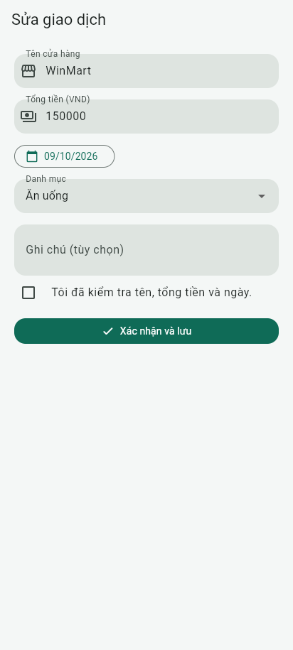

# MINI-PROJECT SHORT TECHNICAL REPORT

**Course:** Cross-Platform Mobile App Development (VKU)  
**Mini-Project Title:** Mini-Project 3 - OCR Expense Tracker & Receipt Parser  
**Application:** Receipt Lens  
**Team / Student Name:** Trần Thanh Quý  
**Student ID:** 23IT228  
**Submission Date:** Chưa nộp; bản nháp chuẩn bị ngày 09/10/2026

> Bản nháp kỹ thuật. Đã build APK release ký riêng, analyze không có issue và 12 test đạt. Người dùng báo test debug OK. Cần bổ sung URL GitHub/video và ảnh chụp thiết bị; chưa xác nhận checklist native của bản release.

## 1. GENERAL INFORMATION & DELIVERABLE LINKS

- **Team Members:** Trần Thanh Quý - 23IT228. Chưa cung cấp thành viên khác, lớp hoặc tỷ lệ đóng góp.
- **Live Demo / APK Download Link:** `../releases/app-release.apk` đã build và xác minh chữ ký v2; chưa có URL tải public.
- **GitHub Repository:** Chưa cung cấp tài khoản/repository và chưa xuất bản.
- **Video Demo:** Chưa quay; kịch bản 2-3 phút có trong `DEMO_SCRIPT.md`.
- **Local package:** Mã nguồn Flutter/Android, tests, CI và tài liệu nằm trong thư mục `receipt_lens/`.

## 2. FEATURE IMPLEMENTATION CHECKLIST

| # | Required Feature | Status | Implementation Details & Acceptance Level |
|---|---|---|---|
| 1 | Camera capture & cropping | Trong APK; cần test lại release | Camera preview, flash, focus/exposure, lifecycle; gallery; image_cropper |
| 2 | ML Kit OCR & regex | 8 parser test đạt; OCR release cần test | TextRecognizer Latin; VND/merchant/date; lọc subtotal/cash/change/tax/metadata |
| 3 | Review & verification | 2 widget test và browser preview | Sửa các trường, raw OCR, bounds overlay; tick kiểm tra rồi mới lưu |
| 4 | Local database & lifecycle | Trong APK; cần test lại release | SQLite CRUD, integer VND, persistent receipt/thumbnail, ảnh mới cleanup nếu DB lỗi |
| 5 | State & custom charts | Đã render browser với dữ liệu mẫu | Riverpod AsyncNotifier, CustomPainter donut/bar hoạt ảnh; không dùng chart library |
| 6 | Light/dark mode | Đã render browser | Material 3, SharedPreferences theme; UI chạy ở 320/412/600 px |

## 3. TECHNICAL ARCHITECTURE & PROJECT STRUCTURE

Pipeline: Camera/Gallery > Crop > ML Kit > ReceiptParser > Review > ReceiptStorage + SQLite > Riverpod > History/CustomPainter.

`core/`: theme/formatters; `models/`: Expense; `services/`: OCR/parser/storage/repository; `state/`: providers; `screens/`: home/capture/review; `widgets/`: charts/receipt preview. `test/` và `integration_test/` chứa test; 12 Flutter test đã đạt trong PowerShell thông thường; native integration test chưa xác nhận.

Review là ranh giới commit. Thiếu ngày, tiền không hợp lệ hoặc chưa xác nhận thì không lưu. DB lỗi thì xóa ảnh mới; lỗi reload sau commit không xóa ảnh đã lưu. Xóa DB trước khi cleanup cache. Camera được release khi inactive. Thumbnail resize chạy ở isolate.

| Trường | Regex/heuristic | Ví dụ |
|---|---|---|
| Tiền VND | `\d{1,3}(?:[., ]\d{3})+` hoặc chuỗi từ 4 chữ số | 150,000 VND; 150.000 đ |
| Ưu tiên tổng | total/thanh toan/tong cong/tong tien, sau chuẩn hóa dấu | TỔNG CỘNG 150.000 đ |
| Loại bỏ | subtotal, tax/vat, cash, change, discount, phone/invoice | Không chọn 200.000 tiền khách đưa |
| Ngày | `\b(\d{1,2})[/\-.](\d{1,2})[/\-.](\d{4})\b` + calendar validation | 31/02/2026 bị bỏ |
| Merchant | Dòng có chữ trong 8 dòng đầu; lọc metadata/địa chỉ | WINMART |

## 4. EMPIRICAL EVIDENCE & SCREENSHOTS

Analyze: không có issue; Flutter tests: 12/12 đạt; release APK: chữ ký riêng v2 đã xác minh. Người dùng báo test debug OK, chưa cung cấp checklist chi tiết hoặc ảnh/video native.

**Nguồn ảnh:** Flutter web preview chạy trong Chrome headless với adapter in-memory và 5 giao dịch mẫu (430.000 đ). Đây không phải screenshot emulator/physical device; chưa chứng minh camera/ML Kit/SQLite native.

1.  Sáng: tổng tháng và donut danh mục.
2.  Tối: donut và cột chi tiêu 7 ngày.
3.  Lịch sử: tìm kiếm, lọc, sửa/xóa.
4.  Form sửa: xác nhận đã kiểm tra trước khi lưu.

Parser gốc được biên dịch Dart 3.13.5 qua DartPad rồi chạy SDK JS trên Node: 10/10 kiểm tra đạt. Browser preview phân tích không có issue, biên dịch thành công; rendering 320/412/600 px không phát hiện Flutter runtime errors. Chưa xác nhận thì save không được gọi; đã xác nhận thì save gọi một lần. Test này dùng repository mẫu, không chứng minh database persistence.

## 5. TECHNICAL CHALLENGES & RESOLUTIONS

1. **OCR nhiễu và số dễ nhầm:** chuẩn hóa dấu khi so nhãn, ưu tiên dòng tổng, lọc tiền thối/tiền khách đưa và metadata. Ngày được kiểm tra calendar, số tiền là integer VND; tất cả đề xuất phải qua review.
2. **Môi trường build bị chặn:** Dart Windows không canonicalize được đường dẫn trong sandbox (OS error 5) nên kiểm tra bằng PowerShell thông thường: analyze không có issue, 12 test đạt và APK release đã build. Các lỗi disk-full, plugin registrant khi dùng --no-pub và R8 optional recognizers đã được xử lý. Không dùng kết quả preview để thay bằng chứng native.

**Giới hạn:** VND nguyên, không đổi ngoại tệ; merchant/date/total là heuristic; ảnh mờ/nghiêng và OCR tách số cần sửa; chưa đo cam kết OCR dưới 100 ms; chưa cấu hình iOS. Đã có signed release APK; cần test lại release với offline/persistence/camera trên điện thoại, thay ảnh thiết bị, quay video và bổ sung thông tin/URL trước khi nộp.
